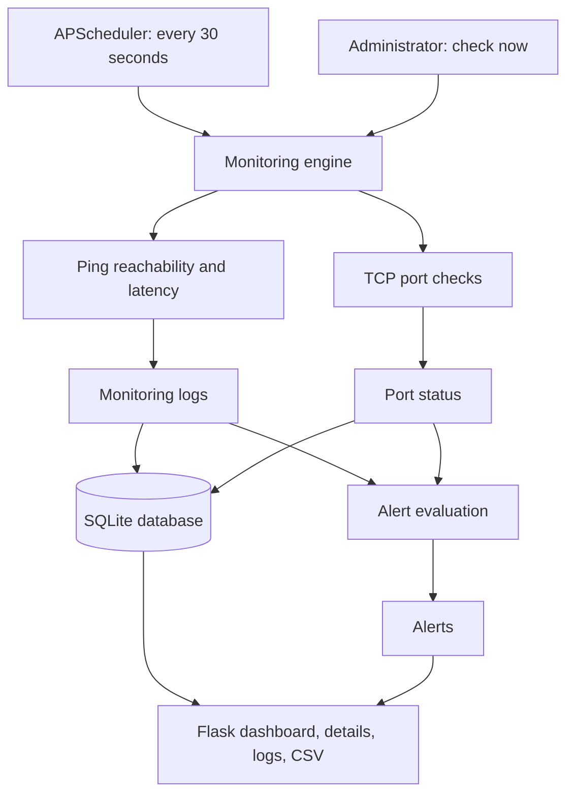

# Network Monitoring and Security Dashboard

> A focused Flask operations console for monitoring authorized devices, TCP services, latency, alerts, and historical network health.

[](https://www.python.org/)
[](https://flask.palletsprojects.com/)
[](test_app.py)
[](#project-scope)

## Overview

Network Monitoring and Security Dashboard is a lightweight, local-first monitoring application built with Python and Flask. It turns recurring reachability and TCP checks into an operational view that helps an administrator understand what is online, what is degraded, and what changed recently.

The project is intentionally compact and practical. It demonstrates a complete monitoring workflow without requiring a cloud platform or external monitoring service.

### Monitoring Loop

`Configure -> Monitor -> Record -> Evaluate -> Alert -> Analyze`

This is a strong fit for a lab network, a portfolio demonstration, or a controlled internal environment where a small, understandable monitoring surface is more useful than a full observability platform.

> **Authorized use only:** Monitor systems, devices, and networks that you own or have explicit permission to monitor.

## What It Provides

| Area | Capability |
| --- | --- |
| Device inventory | Add, edit, inspect, delete, search, enable, or pause devices |
| Availability | Reachability and online/offline status using the operating system ping command |
| Performance | Response-time history, average latency, threshold comparison, and trend visualization |
| TCP services | Monitor SSH, HTTP, HTTPS, MySQL, or any custom TCP port |
| Alerting | Offline, recovery, high-latency, and TCP service state-change alerts |
| History | Device-level details, filterable logs, uptime approximation, and CSV export |
| Automation | Background checks every 30 seconds for enabled devices |
| Demonstration | Safe local seed data for UI review, screenshots, and development |

## Operator Workflow

1. **Register targets:** Add a device with its name, address, type, and description.
2. **Define services:** Attach TCP ports such as `22`, `80`, `443`, or `3306` to the device.
3. **Run checks:** Use an on-demand check or let the background scheduler check enabled devices every 30 seconds.
4. **Review changes:** Inspect current status, latency, port state, recent alerts, and approximate uptime.
5. **Investigate history:** Filter monitoring logs by device or export the complete log set as CSV.

Monitoring can be paused per device without deleting its inventory or historical records.

## Dashboard Preview


The dashboard combines status totals, average latency, searchable inventory, recent alerts, monitored services, recent checks, and a latency chart. The preview was captured from the seeded local demo environment.

## Monitoring Workflow



A device check records the latest status and latency, then compares the result with the previous result. Transitions such as `ONLINE -> OFFLINE` and `OFFLINE -> ONLINE` create meaningful alerts instead of treating every check as a new incident. High-latency alerts use the configured threshold and are throttled to avoid repeated warnings during the same condition.

## Technology Stack

- **Application:** Python 3.10+, Flask 3, Flask-SQLAlchemy
- **Persistence:** SQLite with SQLAlchemy models and relationships
- **Monitoring:** Operating-system ping and Python TCP sockets
- **Scheduling:** APScheduler background scheduler
- **Interface:** Server-rendered HTML templates, CSS, JavaScript, Bootstrap, and Chart.js
- **Testing:** pytest

## Quick Start

### Prerequisites

- Python 3.10 or newer
- Git
- Network access to devices you are authorized to monitor

### Install and run

PowerShell:

```powershell
git clone <your-repository-url>
cd network-monitoring-dashboard
python -m venv venv
.\venv\Scripts\Activate.ps1
pip install -r requirements.txt
python app.py
```

Open [http://127.0.0.1:5000](http://127.0.0.1:5000) and sign in with the local development credentials:

```text
Username: admin
Password: admin
```

The application creates its SQLite database in Flask's `instance/` directory on first startup.

### Populate demo data

Use the seeder when you want a populated dashboard without performing live network checks:

```powershell
venv\Scripts\python.exe seed_demo.py
python app.py
```

The seeder creates sample devices, TCP services, monitoring history, and alerts only when no devices exist. It does not contact the network.

## Configuration

Copy `.env.example` to `.env`, or configure the values in PowerShell before starting the application:

```powershell
$env:SECRET_KEY = "replace-with-a-strong-local-value"
$env:ADMIN_USERNAME = "admin"
$env:ADMIN_PASSWORD = "change-this-password"
$env:LATENCY_THRESHOLD = "200"
python app.py
```

| Variable | Description | Default |
| --- | --- | --- |
| `SECRET_KEY` | Flask session-signing key | Development value |
| `ADMIN_USERNAME` | Administrator login name | `admin` |
| `ADMIN_PASSWORD` | Administrator login password | `admin` |
| `LATENCY_THRESHOLD` | High-latency alert threshold in milliseconds | `200` |

For shared environments, set a strong secret and non-default credentials. Never commit `.env`, credentials, local database files, or the virtual environment.

## Testing

Run the test suite from the project root:

```powershell
venv\Scripts\python.exe -m pytest -q
```

The automated suite covers authentication redirects, invalid login handling, authenticated page rendering, inventory search, CSV access, and missing-device behavior. `test_monitor.py` is a manual diagnostic utility that runs one live device check against the first device in the database; use it only with an authorized target.

## Useful Commands

```powershell
# Run the automated tests
venv\Scripts\python.exe -m pytest -q

# Run one live check against the first configured device
venv\Scripts\python.exe test_monitor.py
```

The manual check records a monitoring result and may create alerts. It requires a configured device and network access.

## Project Structure

```text
network-monitoring-dashboard/
├── app.py                 # Flask routes, authentication, scheduler, dashboard views
├── seed_demo.py           # Local demo-data generator; never performs network checks
├── requirements.txt       # Application and test dependencies
├── test_app.py            # Route and authentication tests
├── test_monitor.py        # Monitoring behavior tests
├── models/
│   ├── database.py        # SQLAlchemy database instance
│   ├── device.py          # Device inventory and health helpers
│   ├── port.py            # Monitored TCP services
│   ├── monitoring_log.py  # Reachability and latency history
│   └── alert.py           # Operational alerts and resolution state
├── monitoring/
│   ├── engine.py          # Device checks and state transitions
│   ├── ping.py            # Ping execution and latency parsing
│   └── port_monitor.py    # TCP service checks and port transitions
├── templates/             # Dashboard, forms, detail, login, and log views
├── static/                # Stylesheet and dashboard chart behavior
├── docs/                  # Documentation and dashboard preview images
├── instance/              # Local SQLite database created at runtime
└── .env.example           # Environment configuration reference
```

## Security and Production Boundary

This repository is a portfolio and controlled-environment project, not a production-ready monitoring platform. Before deploying it beyond local development, address at least:

- Password hashing and a real identity provider
- CSRF protection and stricter input validation
- HTTPS, secure session settings, and secret management
- Role-based access control and audit logging
- Database migrations and a production database
- A production WSGI server and isolated monitoring worker
- Rate limiting, notification delivery, and operational observability

The application should run only in environments where monitoring targets and credentials are explicitly authorized.

The current authentication flow is intentionally simple: one administrator account is read from environment variables and protected routes use a Flask session. It does not yet provide password hashing, multiple users, roles, CSRF protection, or audit history.

## Roadmap

- Harden authentication and add password hashing
- Add CSRF protection and role-based access control
- Support PostgreSQL and formal database migrations
- Make monitoring intervals configurable
- Add email and webhook notifications
- Expand SLA, uptime, and reporting views
- Add Docker, CI/CD, and production deployment configuration
- Broaden automated and integration test coverage

## Project Scope

This project focuses on the core monitoring loop: collect a network signal, persist the result, detect a change, surface an alert, and provide enough history to investigate what happened. It is intended for authorized environments, development systems, and controlled demonstrations.

Production use requires the hardening work described above.
